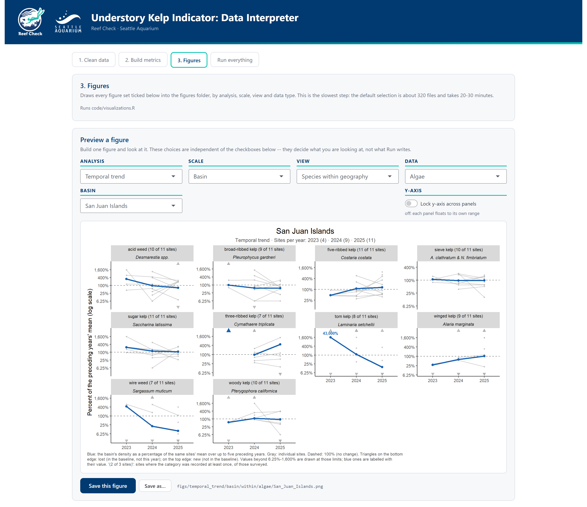

# Data Interpreter GUI

## Purpose

Data Interpreter is a one stop shop for manipulating and visualizing Reef Check's Washington State dataset. The R Shiny app combines the capabilities of R scripts located in this repo's `code` directory, and cleanly guides users through each step in a user interface. With surveys conducted annually for more than 50 sites in Washington waters alone, Data Interpreter will rapidly deliver the latest updates and trends on the health of our understory kelp forests.

  

## Starting it

**Double-click `understory_kelp_indicator/run_data_interpreter.bat`.** That is all. Nothing has to be installed first — not even R.

* **The first time**, it downloads its own copy of R (the version pinned in `gui/launcher/runtime.cfg`, checked against a SHA-256 checksum) and the R packages the app needs, from one fixed day's CRAN snapshot. That takes a few minutes, needs the internet once (about 140 MB to download), and uses about 310 MB on disk. A console window shows the progress.
* **Every time after that**, it starts in a few seconds and opens the app in your browser.
* **To quit**, close the browser tab. The console window closes itself a few seconds later.

The environment lives in `%LOCALAPPDATA%\CCR\understory_kelp_indicator`, outside Dropbox on purpose — an R installation and its packages are over 8,000 files that the sync client would otherwise push to everyone who shares the folder. The app runs only on that environment: any other R installations, package libraries, `.Renviron` or `.Rprofile` files on the computer are never read, so they cannot break it, and it does not change them. (A `.Renviron` pointing R 4.1 at an R 4.5 package library is exactly what produced the old *"procedure entry point … could not be located … digest.dll"* crash.) The private R appears in *Apps & Features* as "R for Windows 4.6.1"; if exactly that version is already installed, it is reused instead of installed twice.

If anything ever goes wrong with the environment, run `run_data_interpreter.bat --repair` from a command prompt (or delete the `%LOCALAPPDATA%\CCR\understory_kelp_indicator` folder) and it is rebuilt from scratch. `setup.log` in that folder records what the last setup did.

From RStudio the app still runs the old way, on whatever R and packages are installed there: open `gui/app.R` and press **Run App**, or run `shiny::runApp("gui")` from the repository folder. Selecting all of `app.R` and running it also works now, logos included.

## Operation

1. **Clean data** — Generates the combined transect table (`results/reef_check_cleaned.csv`) from the four raw Reef Check exports, one row per transect.
    - The default open page for Data Interpreter assumes no data has been processed. If the user has cloned the `understory_kelp_indicator` repo, the GUI will auto-populate each data category with the current raw data file for each category available on GitHub. Should the user wish to update the data source, click "Browse..." and locate within file explorer.
    - A **0** means a category was looked for and not found; a **blank (NA)** means it was not on that survey's datasheet. Several categories were added over the years (UPC superlayer in 2022, Clay in 2023, Acid Weed cover/superlayer in 2024, and several invertebrate and fish species in 2022–2023), and those earlier years are blank rather than zero.
    - The "Withheld Basins" section contains checkboxes to include data from the Northern Coast, Western Strait of Juan de Fuca, and Eastern Strait of Juan de Fuca basins, which are otherwise excluded.
    - The default save location for outputs is `understory_kelp_indicator\results`; however, users may again select "Browse..." to change save location.
    - Select "Run this step" to execute with your selections.
    - "Reset all locations" restores all file and save paths to default.
2. **Build metrics** — Runs `metrics_across_scale.R`, `temporal_trend.R` and `nmds_algae.R`:
    - Transect, site, basin and Puget Sound-wide tables (`metrics_*_scale.csv`) for algae, UPC, invertebrates and fish: each category's average, standard deviation and variance at each scale. Algae, invertebrate and fish values are individuals per m² (count ÷ 60 m²); UPC values are proportions of transect points.
    - The temporal trend metric (`trend_*_scale.csv`, issue #2) at the site, basin and Puget Sound scales: each year's density as a percentage of the mean over up to five preceding years. See the header of `code/temporal_trend.R` for how zeros, new appearances (would-be Inf) and absences (would-be NaN) are handled.
    - An NMDS of the understory algae community (`nmds_algae_*.csv`), one point per transect: Bray–Curtis on Wisconsin-standardized square-root densities, 2-D (stress 0.160), with the 3-D scores and the stress for 1–4 dimensions stored too. It takes a few minutes and is only re-run when the transect table changes; see the header of `code/nmds_algae.R`.
3. **Figures** — Explore any figure, and write whole figure sets to `figs/` (longest run time).
    - **Explore data** builds a figure from four choices, the same four that name the folders Run writes into:
      - **Analysis** — *Temporal trend*, *Average density*, *Average density with standard deviation*, or *NMDS Algae*.
      - **Scale** — *Site* (transects → site), *Basin* (sites → basin) or *Puget Sound* (basins → Puget Sound; *Washington-wide* is offered too when the withheld basins were kept).
      - **View** — *Species within geography* (one place, a panel per species), *Species across geography* (one species, a panel per basin — or, at the site scale, per site in a chosen basin), or *Species composite within geography* (one place, every species on one set of axes). Combinations that make no figure are not offered: Puget Sound is a single geography, so it has no "across" view, and standard-deviation bands are not drawn on a composite.
      - **Data** — Algae, or one of the four UPC groups.
    - A second row asks only for what that figure still needs — which site, basin or region, or which species — and has the **Lock y-axis** switch: off, each panel floats to its own range; on, every panel shares one range so they can be compared by eye.
    - With **NMDS Algae** the controls relabel themselves: *Scale* is the transect, *View* becomes **Color by** (basin, site, year or depth zone — for *site*, pick the basin whose sites are colored, the rest staying gray), **Size by** sizes each point by one species' density on that transect (or all understory algae), **Show** switches the species arrows and the 95% ellipses, and the stress of the 2-D and 3-D solutions is shown alongside.
    - The preview is drawn exactly as the saved file will be. "Save this figure" writes it to the path shown beside the button; "Save as..." lets the user choose.
    - **What to draw** picks whole sets for Run: any combination of analyses, scales, views and data types, plus float or lock. The box underneath counts the files and shows where they go: `figs/<analysis>/<scale>/<view>/<data type>/`. The site scale is unticked by default because it is about 1,500 files. *NMDS Algae* is a fixed set of 21 (every coloring, each basin's sites, and the basin coloring sized by each species), whatever scales, views and data types are ticked.
4. **Run Everything** — Executes all three steps in Data Interpreter from data cleaning through visualizations (with whatever is ticked on each tab).

## Reading the figures

Every figure carries a caption saying what the blue line, gray lines and band are. In short:

* **Blue** is the value at the chosen scale; **gray** lines are the units it averages (transects behind a site, sites behind a basin, basins behind Puget Sound). The standard-deviation version swaps the gray lines for a ±1 SD band among those units.
* The subtitle gives the number of units behind each year (for example *Sites per year: 2022 (1) · 2023 (2) …*). Many sites joined the survey in 2023–2024, so part of a basin's change between years can come from which sites were surveyed, not from the kelp.
* Facet titles end with *(2 of 3 sites)*: the units where the category was recorded at least once, of those surveyed.
* Temporal-trend figures use a doubling (log) axis centered on 100% (no change). Triangles on the bottom edge mark a category **lost** (recorded in the baseline, absent now); on the top edge, **new** (absent from the baseline, recorded now). Values beyond 6.25%–1,600% are drawn at those limits and labeled with their value.
* **NMDS** figures follow the ROV–diver comparison report's style. Each point is one transect, and points close together had similar algae communities. Arrows point to each species' score (the weighted average of the transects it occurs on), so transects in an arrow's direction have more of that species. Ellipses enclose 95% of each group's transects. NMDS1 and NMDS2 share one scale, but the axes themselves have no units or fixed meaning. Stress under 0.2 gives a usable two-dimensional picture (Clarke 1993); the 2-D solution's 0.160 supports reading the broad structure, but not fine detail.
